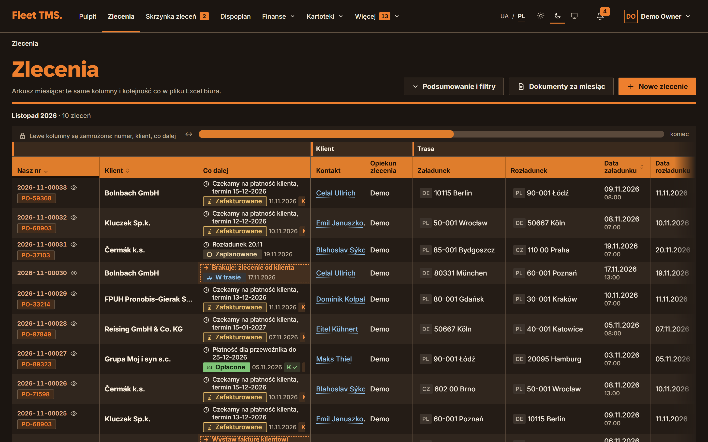
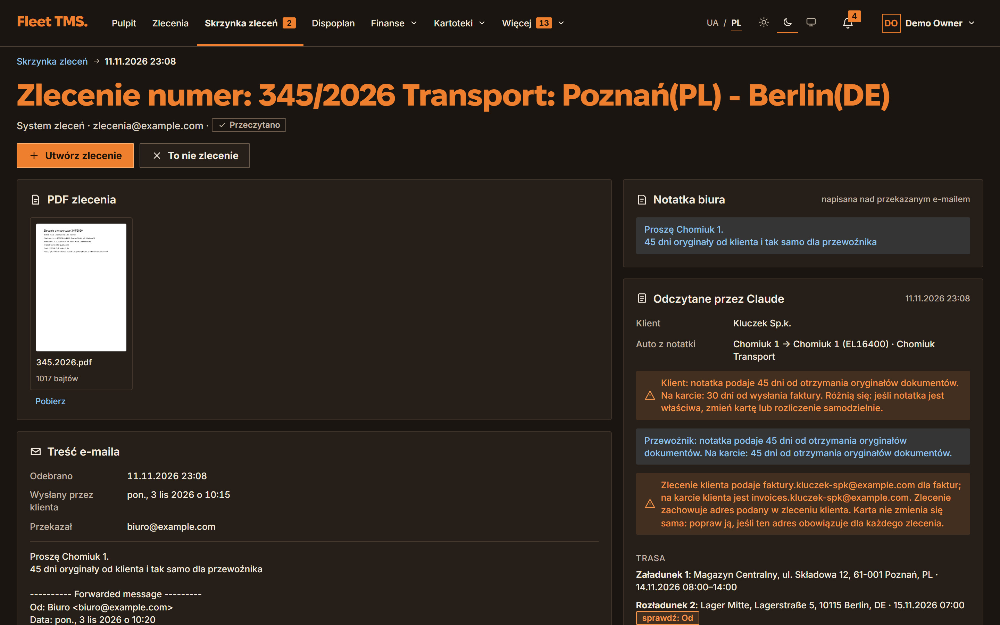
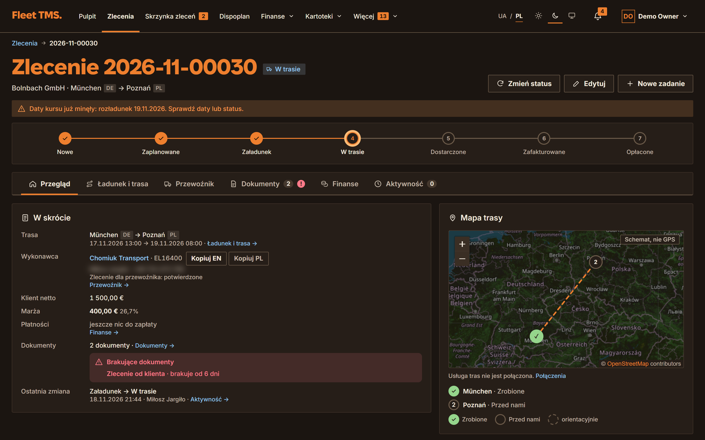
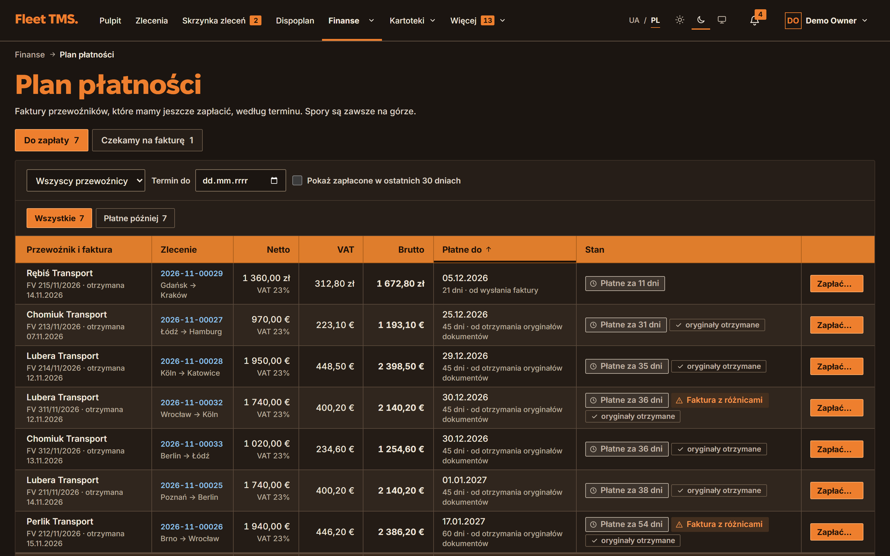
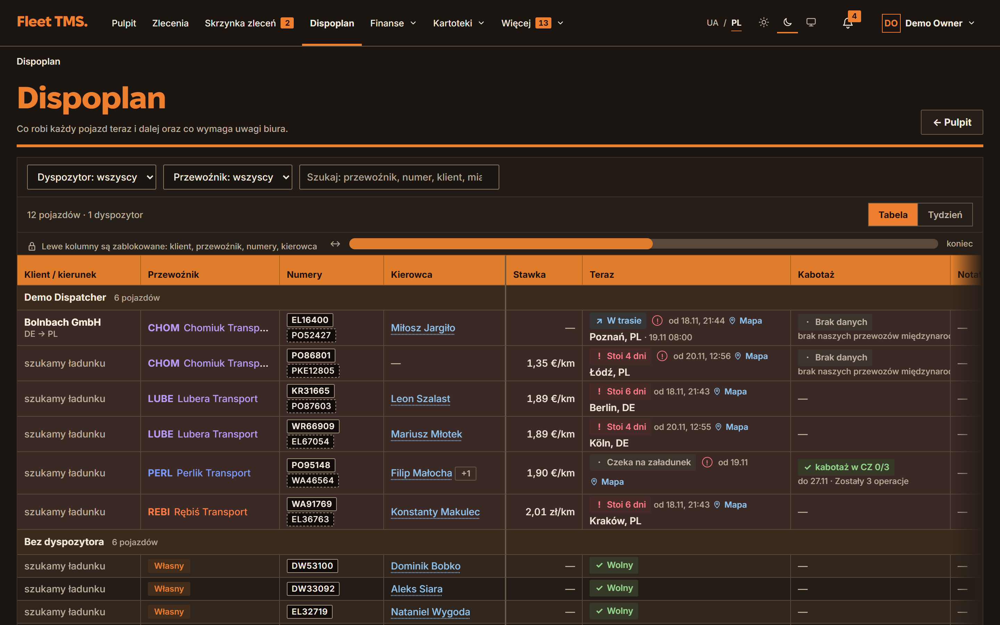
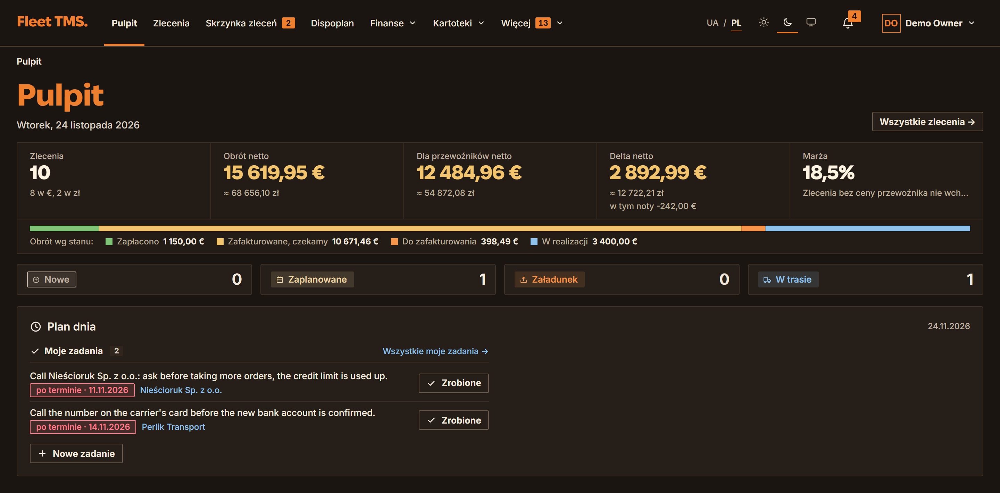
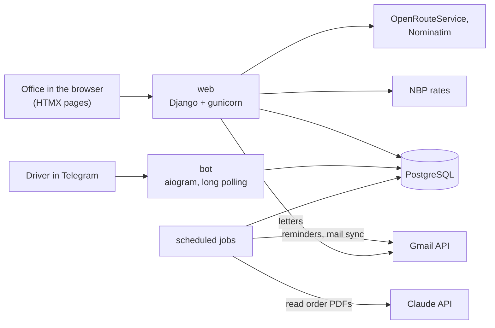

# Fleet TMS

A transport management system I built for a small freight-forwarding company:
one web app instead of Excel sheets, messenger chats and the owner's memory.
The company is preparing to roll it out.

This repository is a showcase: what the system does, screenshots and a few code samples
from it. The full source (24 Django apps, over 6,000 automated tests) is in a private
repository, and I gladly give read access on request, for example before an interview.

All data in this repository and on the screenshots is made up (Faker, `example.com`
addresses). The interface speaks Polish and Ukrainian.

## Before and after

The office (the owner and a dispatcher) organises road freight between Poland, Germany
and the rest of the EU with outside carriers.

| Before | After |
|---|---|
| Orders in an Excel sheet | The same columns as a web table: filters, search that ignores Polish letters, sorting, a quick view beside the list, numbers `YYYY-MM-NNNNN` |
| A client's order arrives as a PDF by e-mail and is typed in by hand | The owner forwards the e-mail, Claude reads the PDF and fills in a draft order, a person checks it and saves |
| Drivers report by phone and messengers | Drivers press "Loaded" and "Unloaded" in a Telegram bot and send the signed CMR there; the order's status and documents update by themselves |
| Margin counted by hand across EUR and PLN | Margin of every order, converted at the NBP mid rate of the right day |
| Who to pay and when: in the owner's head | A payment plan by due date; "pay after the client pays" and an open dispute block a payment |
| Inspection, insurance and licence dates on paper | Reminders 30, 14 and 3 days ahead, on the home page and in a morning e-mail |

## What it does

- **Orders.** A list with the columns of the old sheet, an order page with tabs (overview,
  cargo and route, carrier, documents, finance, activity), several loading and unloading
  places, legs when the cargo is reloaded on the way, a route map with km per country
  (OpenRouteService), and a status flow where every change is logged: who, when, from the
  web or from the bot.
- **Orders from e-mail.** The office mailbox is connected through the Gmail API (read-only
  and send scopes, no password stored). Claude reads the client's PDF and the mail text and
  returns only a fixed JSON schema that pre-fills a draft; the mail is treated as data,
  never as instructions, so a line like "ignore your rules" in a PDF changes nothing.
  A new client can be created from the mail, with its data filled in from the Polish VAT
  register (White List) or VIES.
- **Telegram bot for drivers** (aiogram 3). A driver links their account with a one-time
  code and sees only their current trip: addresses with map points, cargo, loading number,
  a note from the office, no prices. Status buttons go only forward; the office always wins
  a conflict. Files are checked by content and photos are re-encoded, so GPS data is gone.
- **Money.** Settlements with clients and carriers, payment terms counted from the day the
  documents were sent or the originals arrived, overdue payments, credit limits per client or
  group, accounting notes from the bookkeeping program, and the margin in one currency.
- **Fleet.** The carriers' regular vehicles and own trucks, a dispo plan (what every truck
  is doing now), "truck per month" statistics (km, freight, margin, EUR per km) and a
  cabotage counter under the EU rules.
- **Documents and letters.** CMR, orders and invoices per order, a monthly archive as a
  ZIP, a carrier order PDF (WeasyPrint), and template letters to clients and carriers that a
  person previews before sending; every letter is logged.
- **Also:** tasks for the office, a blacklist of companies with warnings on the same NIP,
  IBAN, phone or name, a yearly report and a read-only REST API (Django REST framework).

## Screenshots

| | |
|---|---|
|  |  |
| Claude reads a PDF order from e-mail, a person checks it | Order page: status steps, carrier, margin, route map |
|  |  |
| Carrier payment plan by due date | Dispo plan: what every truck is doing now |

## Security

The system holds the company's money flows and personal data of drivers, so I treated it
as an application security project from the first migration.

- **Access.** Roles from Django groups (owner, dispatcher), every page needs a signed-in
  user, and objects are checked per object, so changing an id in the URL opens nothing
  (IDOR). Every access rule has a test with two users.
- **Sign-in.** Two-factor sign-in (TOTP, django-allauth) for the office, a lock after 5 wrong
  passwords (django-axes), sessions that end after 2 hours idle or 12 hours in total.
  No sign-up page: the owner invites people with a one-time link.
- **Bank accounts.** A new or changed account is always "pending" until the owner confirms
  it after a phone call, with a fresh 2FA code; the page shows recent changes of the
  company's phone and e-mail, the usual first step of invoice fraud. Accounts and the change
  log are never deleted, and a database constraint allows one active account per currency.
- **Files.** Type checked by content (PDF, JPEG, PNG), 15 MB and 40 megapixel limits,
  photos re-encoded from pixels (no EXIF, no GPS), random file names, storage outside the
  public folder, downloads only through views that check permissions.
- **Secrets.** Keys for Claude, Gmail, Telegram and OpenRouteService are entered by the
  owner on a "Connections" page with a fresh 2FA code, stored encrypted (Fernet) and never
  shown back; nothing secret in the repository or in logs.
- **Pages and logs.** A strict Content-Security-Policy (no inline scripts), HSTS and secure
  cookies in production, no personal data in logs or Sentry (`send_default_pii=False`).
- **In CI.** ruff, the test suite on PostgreSQL, bandit, pip-audit and
  `manage.py check --deploy`.

## Tech stack

Python 3.12, Django 5.2 LTS, PostgreSQL 16 (psycopg 3), HTMX 2, Tailwind CSS 4 (no Node.js),
aiogram 3, Claude API (`anthropic` SDK), Gmail API, NBP API, OpenStreetMap and
OpenRouteService, WeasyPrint, Docker Compose, pytest with pytest-django
and factory-boy, ruff, bandit, pip-audit, GitHub Actions.

## How it is built

- 24 Django apps (`apps/`): orders, inbox, bot, fleet, documents, letters, reminders,
  payables, parties, reports and others.
- Business rules live in service functions, not in views or the admin. One function writes
  an order's status and its log entry ([code/orders/status.py](code/orders/status.py)); invoices
  and payments go through their own service, bank accounts through another.
- The order number `YYYY-MM-NNNNN` comes from a counter per month, taken under
  `select_for_update()` in a transaction, with a test that creates orders from several
  threads at once ([code/orders/](code/orders/)).
- Money is always `Decimal`; margins, payment terms and overdue days are calculated, not
  stored.
- Over 6,000 automated tests, all on PostgreSQL.

## Code samples

A few files from the private repository, chosen to show how I make decisions. They are
excerpts, so they do not run on their own.

| File | What it shows |
|---|---|
| [code/orders/status.py](code/orders/status.py), [choices.py](code/orders/choices.py) | Status changes: one function writes the status and its history row; going back or cancelling needs a reason; a stale page cannot move an order someone else has moved |
| [code/orders/numbering.py](code/orders/numbering.py), [test_numbers.py](code/orders/test_numbers.py) | Order numbers `YYYY-MM-NNNNN`: a counter per month under a row lock, tested with 8 threads that start at the same moment |
| [code/inbox/reading.py](code/inbox/reading.py) | Claude reads an order PDF: a fixed JSON schema (pydantic), no tools, the e-mail is data and never instructions, a daily limit and one request per press |
| [code/documents/files.py](code/documents/files.py) | Uploaded files: type from the bytes, not the name; size and pixel limits; photos saved again from their pixels, so EXIF and GPS are gone |
| [code/documents/download.py](code/documents/download.py), [test_download.py](code/documents/test_download.py) | Downloads only through a view that checks the user; a signed-out visitor gets the same 404 for a real and a missing file |
| [code/bot/test_carrier_drivers.py](code/bot/test_carrier_drivers.py) | IDOR in the Telegram bot: another driver gets nothing of a leg that is not theirs, not even with a button copied from another phone |
| [code/documents/cmr_cutoff.py](code/documents/cmr_cutoff.py) | One business rule in one place: which CMR closes a trip, shared by the bot, the pages and the letters |

## Author

Yurii Savaryn, [LinkedIn](https://www.linkedin.com/in/yurii-savaryn-ai).
Before IT I worked for over 8 years as an upholsterer and then in a logistics back office,
so I build software around how an office really works.

## License

Copyright (c) 2026 Yurii Savaryn. All rights reserved.

The code is published as a portfolio: you may read it here, but not copy, use or
distribute it without my written permission.
